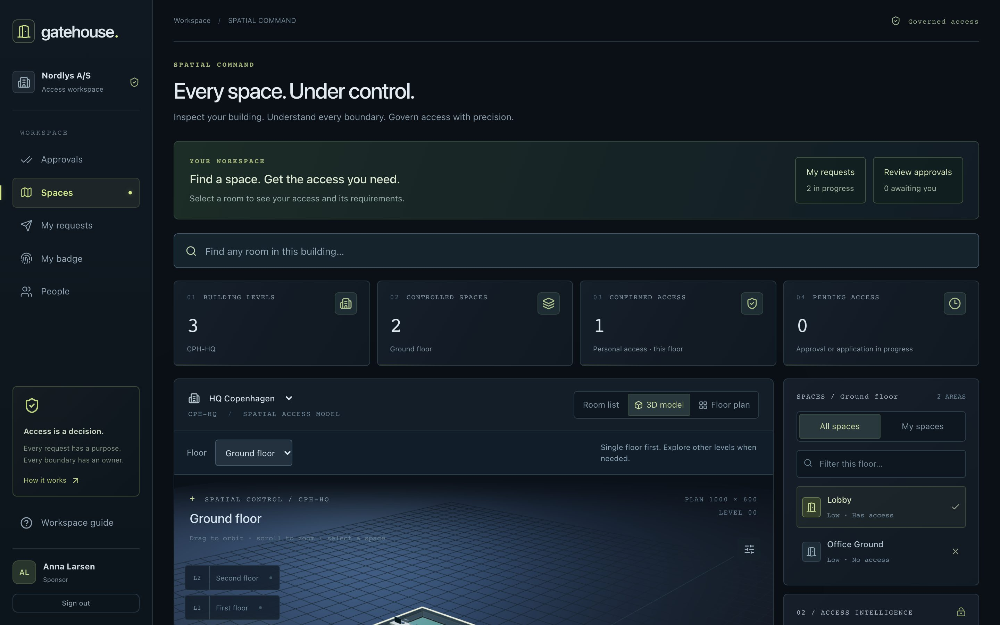
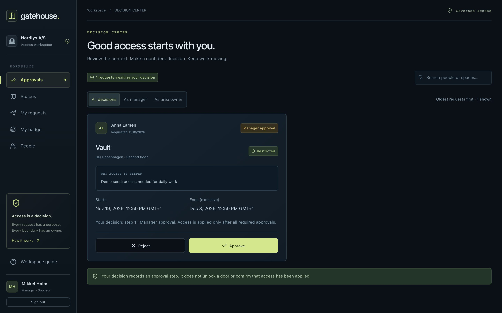
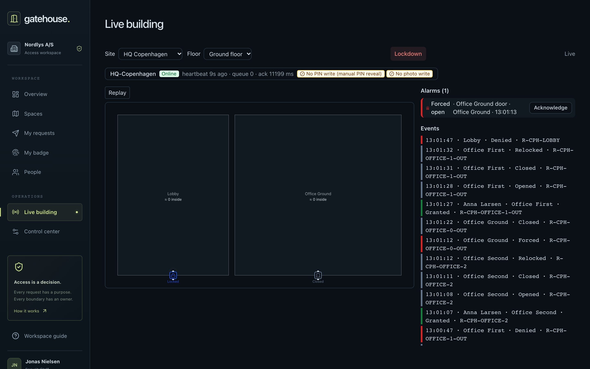
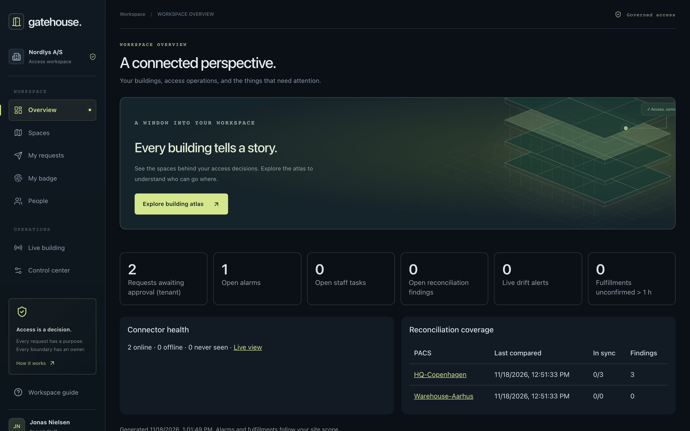
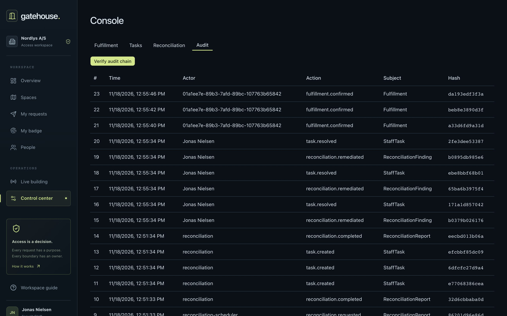
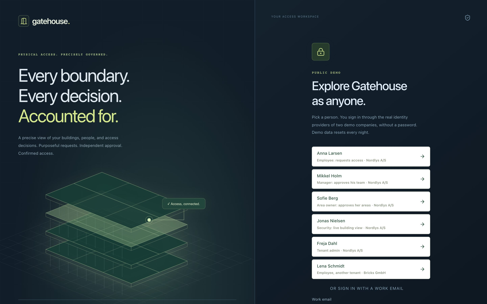
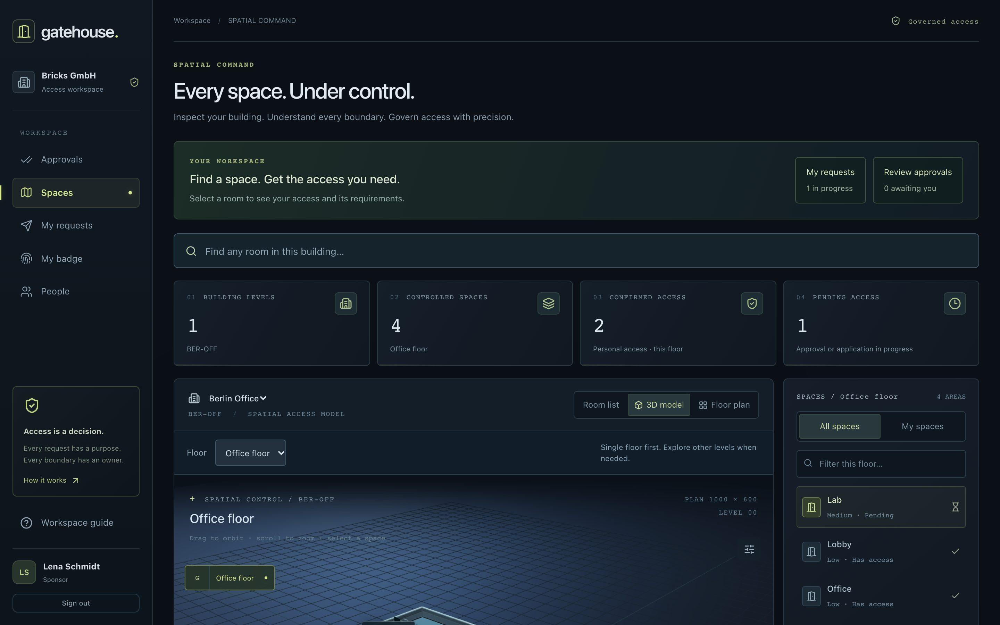
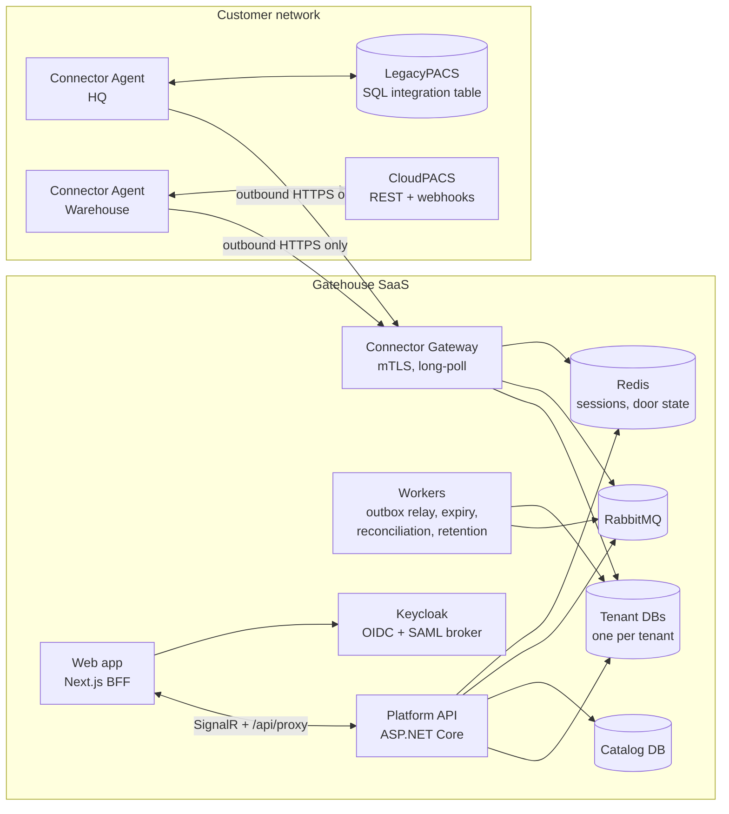
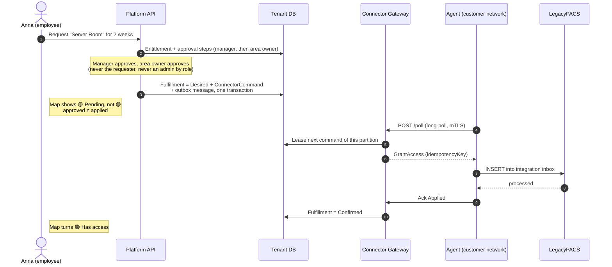

# Gatehouse

[](https://github.com/ristic583/gatehouse/actions/workflows/ci.yml)


**Multi-tenant physical access governance on top of existing access control systems.**

People request access to a room by clicking it on a building map. The right people approve it. A connector agent inside the customer's network applies the change to whatever access control system (PACS) the building runs. A live floor plan then shows what is really happening at every door.

**[Try the live demo →](https://gatehouse.stefanristic.com)** Pick a person (employee, manager, area owner, security, admin, or someone from a second company) and you are signed in with one click, through the real identity providers of two demo companies. The data resets every night.

<p align="center"></p>

<table>
  <tr>
    <td width="50%"></td>
    <td width="50%"></td>
  </tr>
  <tr>
    <td><b>Approvals</b>: routed by the room's security level, oldest first, never your own request.</td>
    <td><b>Live building</b>: door states, badge swipes, alarms and lockdown, in real time over SignalR.</td>
  </tr>
  <tr>
    <td width="50%"></td>
    <td width="50%"></td>
  </tr>
  <tr>
    <td><b>Operations</b>: fulfillment, connector health and tasks for anything that did not apply.</td>
    <td><b>Audit</b>: append-only and hash-chained, verified in the UI.</td>
  </tr>
  <tr>
    <td width="50%"></td>
    <td width="50%"></td>
  </tr>
  <tr>
    <td><b>Sign-in</b>: email first, then the company's own OIDC or SAML provider. The demo adds one-click personas.</td>
    <td><b>Second tenant</b>: its own database, identity provider, theme and terminology.</td>
  </tr>
</table>

## Contents

- [Run it](#run-it)
- [The problem](#the-problem)
- [What Gatehouse does](#what-gatehouse-does)
- [Architecture](#architecture)
- [The hard parts, and how they are solved](#the-hard-parts-and-how-they-are-solved)
- [By the numbers](#by-the-numbers)
- [Quality and testing](#quality-and-testing)
- [Tech stack](#tech-stack)
- [Decision log](#decision-log)
- [Delivery and roadmap](#delivery-and-roadmap)
- [How it was built](#how-it-was-built)
- [Repository map](#repository-map)
- [License](#license)

## Run it

### Development (.NET Aspire)

Needs the .NET 10 SDK, Node 24 and Docker.

```bash
dotnet tool restore
```

```bash
cd src/web && npm ci && cd ../..
```

```bash
dotnet run --project src/Gatehouse.AppHost
```

One command starts everything: Postgres, both Keycloaks, Redis, RabbitMQ, object storage, the migrator (which creates and seeds the demo tenants), API, Workers, Connector Gateway, two agents, three simulators and the web app on <http://localhost:3000>. The login page offers the demo personas; the generated demo password stays on the server (`dotnet user-secrets list --project src/Gatehouse.AppHost`, key `Parameters:demo-user-password`, if you want to sign in by email).

### The demo stack (Docker Compose)

What runs at the live demo: production builds of every service, the two demo tenants, their identity providers, two simulated PACS with their agents and a simulated building, behind one HTTP entry.

```bash
deploy/demo/setup.sh
```

Then open <http://localhost:8088>. Details, public hosting and the nightly reset: [`deploy/demo/README.md`](deploy/demo/README.md).

### Tests

| Suite | Command |
|---|---|
| Unit | `dotnet test tests/Gatehouse.UnitTests` |
| Contract | `dotnet test tests/Gatehouse.ContractTests` |
| Integration (Docker) | `dotnet test tests/Gatehouse.IntegrationTests --filter "Category!=AppHost"` |
| Full system (Docker) | `dotnet test tests/Gatehouse.IntegrationTests --filter "Category=AppHost"` |
| Web | `cd src/web && npm run lint && npm run typecheck && npm test && npm run build` |
| End to end (AppHost running) | `cd tests/e2e && npm ci && GATEHOUSE_DEMO_PASSWORD=... npx playwright test` |

CI ([`.github/workflows/ci.yml`](.github/workflows/ci.yml)) runs build, format check, unit, contract, integration and web tests and scans NuGet and npm dependencies for known vulnerabilities. The README screenshots come from `GATEHOUSE_SCREENSHOTS=1 npx playwright test --project=screenshots`.

## The problem

Large organisations already own physical access control: card readers, door controllers and a vendor server in each building, often from several vendors. Opening doors is a solved problem. **Governance** is not:

- Who should be allowed into which room, and who approved it?
- Was the approved change *really* applied in the PACS, or is it stuck?
- When someone leaves, is every card and access level removed in every building?
- Does the PACS still match what was approved, or did someone add people by hand?

**Gatehouse is a governance layer, not an access control system.** Door controllers keep making the open/deny decision locally, so doors keep working when the cloud is down. Gatehouse decides *who should have what*, gets it approved, pushes it to the PACS and **tracks whether it was really applied**.

## What Gatehouse does

| Persona | What they get |
|---|---|
| **Employee** | A building map that shows, room by room, *Has access*, *Pending*, *No access* or *Unknown*. Request access in two clicks; activate their own card; set a PIN. |
| **Manager / Area owner** | An approval inbox routed by the room's security level (manager first, owner second for sensitive rooms). Rosters of who can enter the areas they own; revoke in one click. |
| **Security staff** | A fulfillment console (desired vs. confirmed state), staff tasks for anything that failed, emergency revoke, task-scoped PIN reveal, reconciliation findings. |
| **Security operations** | A **live building view**: SVG floor plans with door states, badge swipes, forced-door and held-open alarms, occupancy, connector health, momentary unlock and **lockdown** of a door, area, floor or site. |
| **Tenant admin** | People, sites, security levels, connectors, per-tenant theming with a WCAG contrast check, GDPR retention settings. |
| **Tenant admin (onboarding)** | A guided onboarding flow: connect the company's OIDC or SAML identity provider (with a test-connection step), import employees from CSV with a dry run, draw sites, floors and areas in a plan editor (undo/redo, snapping, 3D preview), register PACS instances and enrol a connector with a one-time token. |
| **Platform operator** | A separate admin panel above all tenants: create a tenant (database, migrations, baseline, identity organisation and first admin invite run as a resumable provisioning step machine), suspend and reactivate, retry failed provisioning, statistics, alerts and a hash-chained platform audit log. |

A new customer is onboarded **end to end from the UI**: no CLI, no seed data, no editing of identity-server files. Two demo tenants also run side by side: **Nordlys A/S** signs in through OIDC, **Bricks GmbH** through SAML. Each has its own database, theme and terminology, with zero data overlap.

## Architecture



**Golden rule:** nothing in the cloud ever opens a connection *into* the customer network. Agents pull commands and push acknowledgements and door events over outbound HTTPS.

**Shape of the code:** a **modular monolith** (13 feature modules: Tenancy, Identity, Sites, People, Access, Fulfillment, Credentials, Audit, Connectors, LiveBuilding, Reconciliation, Tasks, Theming) with process boundaries only where they are real: the internet-facing **Connector Gateway** (own auth, different load profile) and the **Agent** (different network, ships to customers separately and depends only on a small contracts package). Everything is orchestrated locally with **.NET Aspire**: one command starts Postgres, Keycloak (plus an upstream IdP that plays the customers' identity providers), Redis, RabbitMQ, S3-compatible object storage, a migrator, API, Workers, Gateway, two agents, three simulators and the web app.

### The core flow: request → approve → fulfil → confirm



## The hard parts, and how they are solved

### 1. Tenant isolation that cannot be forgotten
- **Database per tenant** plus a catalog database ([ADR-001](docs/adr/001-database-per-tenant.md)). A missing `WHERE tenant_id = …` cannot leak another company's people, cards or movements, because that connection only reaches one tenant's data. Offboarding is `DROP DATABASE`.
- The tenant comes **only** from something the caller cannot forge: the signed token's `tenant_id` claim (users), the client certificate (agents) or a header set by our own code (messages). Never from a URL or a body.
- Redis keys and SignalR groups are namespaced `tenant:{id}:…`; background jobs iterate tenants and open a fresh scope per tenant.
- **Every read endpoint has a cross-tenant 404 test.**

### 2. Reaching servers you are not allowed to call
- PACS servers sit behind corporate firewalls. The connector agent calls *out* with **HTTPS long-poll** ([ADR-003](docs/adr/003-long-poll-agent-channel.md)): it survives TLS-inspecting proxies that break WebSockets and gRPC streams, and any gateway replica can answer.
- Agents authenticate with **per-agent client certificates** issued at enrolment from a one-time token; only the token's hash is stored.
- Commands live in a **table, not a queue** ([ADR-005](docs/adr/005-outbox-and-messaging.md)): strict order per person (grant before revoke), at most one in flight per partition, 120 s leases with redelivery, exponential backoff, a **priority lane** for emergency revoke and lockdown, and **supersession** (a revoke cancels a still-queued grant). They survive hours of agent downtime.

### 3. Exactly-once *effects* over at-least-once delivery
- **Transactional outbox per tenant database**: the state change and the outgoing message commit together; a relay claims rows with `FOR UPDATE SKIP LOCKED` and publishes through MassTransit. MassTransit's own outbox was not used because it assumes a single database.
- Consumers are idempotent (`processed_messages` in the same transaction). The agent keeps a local SQLite store of processed **idempotency keys**, so a redelivered command is re-acknowledged without touching the PACS again.
- After the last retry a command becomes **Failed**, a staff task opens and people are alerted. Nothing silently disappears.

### 4. One contract, very different vendors
- Two simulated vendors are deliberately opposite: **LegacyPACS** (an SQL "integration table" processed by a slow, sometimes failing controller service, events polled by cursor) and **CloudPACS** (REST with rate limits, random 5xx, eventual consistency and HMAC-signed webhooks).
- Both sit behind one `IPacsAdapter` contract. A **14-case conformance suite** (idempotent upserts, replayed grants, revoked rows exported inactive, transient vs. permanent failures, "adapter never throws") runs against **every** adapter. Adding a vendor means adding a fixture and making the suite green.
- What a vendor cannot do is declared as **capabilities**. The UI greys out unsupported actions and explains the gap instead of failing at runtime; where a vendor has no native end dates, the agent schedules the removal itself.

### 5. Never claim more than you know
- Gatehouse keeps **desired** state (approved) and **confirmed** state (acknowledged by the PACS) apart. The map turns green only after confirmation. With the connector offline it says **Unknown** rather than guessing.
- **Reconciliation** exports the PACS state in chunks and compares it with confirmed state: *Missing in PACS*, *Extra in PACS*, *Mismatch*, *Expired still present*. "In sync" is reported only for records actually compared, with coverage recorded. Each finding becomes a remediation task.
- **Live drift detection:** an `AccessGranted` door event for someone without a confirmed entitlement raises an alarm immediately.

### 6. A live building, in real time
- Door events flow `PACS → adapter → normalized DoorEvent → gateway → RabbitMQ → partitioned event store + Redis state → SignalR`. An explicit **door state machine** covers Locked, Unlocked, Open, HeldOpen, ForcedOpen, Lockdown and scheduled unlocks.
- Events are stored in **native Postgres daily partitions** ([ADR-006](docs/adr/006-door-event-storage.md)), so retention means dropping a partition, not a mass delete.
- A **building simulator** walks seeded people through realistic days and can inject tailgating, forced doors, held-open doors, connector outages, slow PACS and "revoked card still works".

### 7. Security and compliance by construction
- **No self-approval and no admin-implies-approver.** Enforced in the domain *and* in authorization handlers, each rule with its own test. Approvers come from data (manager relation, area owners), not from identity-provider roles.
- **Append-only, hash-chained audit** (`SHA-256(previousHash + canonical payload)`), written in the same transaction as the decision, protected by database triggers, with a verifier and "Audit chain verified ✓" in the UI.
- **Tokens never reach the browser:** Next.js is a backend-for-frontend; the browser holds only an `HttpOnly` session cookie ([ADR-002](docs/adr/002-keycloak-organizations.md)).
- **PINs** are envelope-encrypted, masked everywhere, revealable only by the security staff member assigned to that task, re-masked after 30 s, and each reveal is audited *without* the value. A **log redaction test suite** proves PINs, tokens, secrets and card numbers never reach the logs.
- **GDPR:** per-tenant retention rules, an anonymisation job, photo limits.
- **Security regression suite:** cross-tenant and role sweeps generated from the route table (every route, every role), BFF session attacks, SSRF, markup and CSV injection, upload abuse, production-mode checks and in-process attacks on the connector gateway. An own penetration test produced **14 findings, all fixed with regression tests**. Card numbers are hashed with a per-tenant HMAC key; CSP, HSTS and frame headers on web and API; rate limits on sign-in, the gateway and tenant creation.

### 8. Enterprise identity
- **Keycloak** brokers each tenant's own identity provider: one realm, one *Organization* per tenant, home-IdP discovery by email domain. Nordlys signs in via OIDC, Bricks via SAML 2.0, guests via single-use **magic links**.
- Platform operators live in a **separate realm with mandatory OTP** and a separate token audience, so operator rights can never be derived from a tenant token ([ADR-009](docs/adr/009-platform-operators-and-runtime-tenant-provisioning.md)).
- **Runtime tenant provisioning** drives the Keycloak admin API through a port: organisation, verified email domain, IdP aliases and the first admin's invitation email. Tenant-supplied metadata URLs are fetched behind an **SSRF guard** (HTTPS only, no redirects, private and loopback addresses refused, re-checked at connect time).

### 9. A spatial, accessible, themeable UI
- A graphite workspace with a **real WebGL building model** (Three.js / React Three Fiber) built from the actual floor polygons: extruded rooms, walls and door openings; building, exploded and isolated-floor layouts; orbit, zoom, cutaway, X-ray and room focus. Rendering pauses off-screen and respects reduced motion.
- **Task-first flows:** building-wide room search with keyboard navigation, an inspector instead of modals, a three-step request wizard (who and where → when and why → review), oldest-first approvals with an explicit final review, and a landing page chosen by role. Phones default to a room list with larger targets.
- **Email-first sign-in:** the app collects only the email and hands it to Keycloak as a login hint, which routes to the right company IdP. The app never sees a password or derives tenancy from the email.
- If WebGL is unavailable the scene falls back to an accessible SVG schematic, and nothing (room list, inspector, requests) depends on canvas hit-testing. Floor maps are **plain SVG React components** ([ADR-007](docs/adr/007-map-rendering-svg.md)): every area is a real DOM element, so keyboard, screen readers and Playwright selectors all work.
- Access state is shown by **icon + label + pattern, never colour alone**. Tenants can theme colours, typography, radius, logo and terminology ("Area" → "Zone"), but **cannot** theme away state colours. A WCAG AA contrast check runs when a theme is saved.

### 10. Observable end to end
- **OpenTelemetry** traces follow a click from the browser through the API, the outbox and the connector command to the agent and the door: the W3C `traceparent` is persisted on outbox rows and connector commands so the trace survives every asynchronous hop.

### 11. Hardened, measured, deployed
A whole milestone (43 tasks) went into hardening instead of features:
- **20 physical-access scenarios** run against the full system with simulators: agent outages, PACS refusals, revoke targeting the granted level, access windows, card and termination flows, live events, governance races, fresh tenants.
- **Load test** (k6) on a production-sized 2 vCPU / 2.5 GB machine: 20 badge swipes per second with p95 under 0.9 s to the live map and **zero lost or duplicate events**; 20 parallel approvers produce **zero duplicate fulfillments**.
- **Connection economics:** bounded per-tenant concurrency and pool release cut peak database connections for 49 tenants from ~100 ("too many clients") to 39; a Redis-signalled outbox relay cut idle polling from 84 connects/s to 0 while relaying a new message in ~340 ms ([ADR-005 amendment](docs/adr/005-outbox-and-messaging.md#amendment-2026-11-16-pr-28)).
- **Backup and restore drill:** a production backup in 30 s, restore in 102 s, verified by row counts and **intact audit hash chains**; the GDPR export and retention jobs were then exercised on the restored copy.
- **Architecture tests** enforce layer dependencies, naming rules, file and line size and that every write command has a validator; allow-lists went to zero (or each entry carries a reason).
- **Deployment** with Docker Compose and Caddy: a clean production install without demo data, a "PACS lab" that plays a customer site (company IdP, two PACS, agents, building simulator) so a tenant is onboarded and tested entirely through the normal UI, and the public demo stack in [`deploy/demo`](deploy/demo).

## By the numbers

Snapshot after milestone M11, November 2026.

| | |
|---|---|
| Production C# (excluding migrations) | **~38,500 lines** |
| Web app (TypeScript / React) | **~25,000 lines**, 26 routes, 23 feature folders |
| Test code (C#) | **~31,000 lines** |
| Automated tests, last green runs | **1,600+**: 569 unit, 640 integration, 28 contract, 34 full-system, 262 web, 68 end-to-end |
| Line coverage (.NET) | **81.8%** overall; Domain 91%, Application 90% |
| HTTP endpoints / use-case handlers | **125** / **142** |
| Deployable hosts and simulators | API, Workers, Connector Gateway, Agent, CLI, 2 vendor adapters, 3 simulators |
| Architecture decision records / interface contracts | **9** / **5** |
| Planned and delivered tasks (M1–M11) | **210+**, each with explicit "done when" tests |

## Quality and testing

| Layer | What it proves | Tools |
|---|---|---|
| **Unit** | Domain rules and use cases without I/O: approval routing, state calculator, door state machine, reconciliation comparer, hash chain | xUnit v3, `FakeTimeProvider`, hand-written fakes |
| **Integration** | Real API against real Postgres, RabbitMQ and Redis: authorization, tenant isolation, outbox, gateway delivery semantics, log redaction | Testcontainers, `WebApplicationFactory` |
| **Contract** | Every PACS adapter satisfies the same 14 behaviours | Abstract generic test class per vendor fixture |
| **Full system** | The whole distributed system boots; 20 physical-access scenarios end to end through agents and simulators | `Aspire.Hosting.Testing` |
| **Architecture** | Layer dependencies, naming, size limits, validators on every write command | xUnit rules over the source tree |
| **Security** | Route-table-generated cross-tenant and role sweeps, session, SSRF, injection and gateway attacks | xUnit + Testcontainers |
| **Web** | Components and hooks | Vitest, Testing Library |
| **End to end** | The spec's acceptance scenarios and tenant onboarding, in a browser, against the running system (68/68 green on the first run against a fresh system) | Playwright |
| **Load** | Swipe and approval throughput, latency, duplicates | k6 |

Engineering choices that keep this fast and honest:

- **Every integration test class gets its own catalog and tenant databases**, cloned in milliseconds from a migrated, seeded Postgres template (`CREATE DATABASE … TEMPLATE`), so classes run **in parallel** without shared state. No "restore the data afterwards".
- Test containers are **reused across runs**; Playwright stores sign-in once per persona and runs specs in parallel.
- **Tiered runs:** the touched module's tests per task, the full integration suite every few tasks, everything at milestone end. A GitHub Actions pipeline covers build, format check, unit, contract, integration and end-to-end; Prettier and ESLint enforce web conventions.
- `TreatWarningsAsErrors`, nullable reference types and the latest analyzers on every project; TypeScript strict with `noUncheckedIndexedAccess`.
- Expected failures are `Result` values with stable error codes mapped to RFC 9457 problem details; exceptions are reserved for bugs.

## Tech stack

| Layer | Choice |
|---|---|
| Backend | .NET 10, ASP.NET Core Minimal APIs, EF Core 10 + Npgsql, FluentValidation, Serilog |
| Messaging | RabbitMQ, MassTransit 8, custom per-tenant transactional outbox |
| Data | PostgreSQL (catalog + database per tenant, daily partitions), Redis (BFF sessions, door state, SignalR) |
| Identity | Keycloak 26 (Organizations, OIDC + SAML brokering, magic links, OTP for operators), mTLS for agents |
| Real time | SignalR with tenant- and site-scoped groups |
| Edge | .NET worker service agent with SQLite stores, vendor adapters |
| Web | Next.js 16 App Router, React, TypeScript strict, Tailwind v4, shadcn/ui, TanStack Query, Framer Motion, Three.js / React Three Fiber |
| Orchestration and telemetry | .NET Aspire, OpenTelemetry |
| Testing | xUnit v3, Testcontainers, Aspire.Hosting.Testing, Vitest, Testing Library, Playwright, k6 |
| Delivery | Docker Compose, Caddy, GitHub Actions |

Deliberately **not** used: MediatR (plain handler classes registered explicitly, so the flow is readable), AutoMapper, any second ORM.

## Decision log

Every significant decision is an ADR with context, decision, consequences and rejected alternatives. They are in [`docs/adr`](docs/adr).

| # | Decision |
|---|---|
| [001](docs/adr/001-database-per-tenant.md) | Database-per-tenant with a catalog database |
| [002](docs/adr/002-keycloak-organizations.md) | One Keycloak realm with Organizations; Next.js backend-for-frontend |
| [003](docs/adr/003-long-poll-agent-channel.md) | HTTPS long-poll for the connector agent channel |
| [004](docs/adr/004-modular-monolith.md) | Modular monolith; process boundaries at the gateway and the agent |
| [005](docs/adr/005-outbox-and-messaging.md) | Custom per-tenant outbox relay on MassTransit 8; a command table for connectors |
| [006](docs/adr/006-door-event-storage.md) | Door events in native Postgres daily partitions |
| [007](docs/adr/007-map-rendering-svg.md) | Plain SVG React components for floor maps |
| [008](docs/adr/008-in-process-side-effects-before-m4.md) | In-process side effects until the event backbone exists |
| [009](docs/adr/009-platform-operators-and-runtime-tenant-provisioning.md) | Platform operator realm and runtime tenant provisioning |

For the reasoning that connects them, start with **[Design reasoning: from the problem to the architecture](docs/guide/00-design-reasoning.md)**.

## Delivery and roadmap

Milestones follow **risk, not screens**: if single sign-on and tenancy do not work, nothing else matters, so they came first.

| # | Milestone | Status |
|---|---|---|
| M1 | Skeleton: Aspire, catalog + tenant databases, OIDC and SAML sign-in for two tenants | ✅ Done |
| M2 | Domain + map: sites, areas, requests, approval routing, no self-approval | ✅ Done |
| M3 | Manual fulfillment: desired vs. confirmed, staff console, hash-chained audit, tasks | ✅ Done |
| M4 | Event backbone + agent: outbox, gateway, long-poll, idempotency, first vendor | ✅ Done |
| M5 | Live building: simulator, door events, SignalR floor plan, alarms, lockdown | ✅ Done |
| M6 | Second vendor: CloudPACS adapter, capability gaps, conformance suite green for both | ✅ Done |
| M7 | Reconciliation: exports, four finding types, coverage, remediation, live drift alerts | ✅ Done |
| M8 | Lifecycle: HR sync, terminations, renewals, sponsors, magic-link guests, cards, PIN reveal | ✅ Done |
| M9 | Polish: theming + contrast check, GDPR retention, OpenTelemetry, full Playwright suite | ✅ Done |
| — | UI redesign: WebGL 3D building, email-first sign-in, guided request wizard, task-first navigation | ✅ Done |
| M10 | Tenant onboarding from the UI: platform panel, provisioning, IdP setup, plan editor, connector enrolment | ✅ Done |
| M11 | Hardening: scenario suite, security tests + own pentest, architecture rules, coverage, backup/restore and GDPR drills, load test, production deployment | ✅ Done |
| M12 | First-customer readiness: first real PACS vendor adapter, external pentest, monitoring and alerting, automated off-site backups | 📋 Next |
| M13 | Integration + deployment: generic SQL adapter, hybrid and fully offline packages, signed agent images with auto-update | 📋 Planned |
| M14 | Governance phase 2: tenant-defined security levels, delegation and escalation, access-review campaigns | 📋 Planned |

## How it was built

Gatehouse is built **spec-first**, the way a team would build it:

1. A product **spec** with acceptance scenarios and a scripted demo.
2. **ADRs** for every decision with real alternatives.
3. **Interface contracts** (domain model and error codes, authorization matrix, connector protocol, adapter interface, messages) that are written *before* the code and win when code disagrees.
4. A **plan per milestone**: small tasks, each listing what to read, which files it may touch, the exact names to use and the tests that define "done".
5. An **as-built summary** and a [code map](docs/codemap.md) after each milestone, so the next one is planned from facts, not memory. (Plans and as-built notes are working documents and are not part of this repository.)

Implementation was done with **AI coding agents (Claude Code) working inside those guardrails**: one task at a time, only the files the task allowed, contracts never changed silently, and nothing counted as done until its named tests, the build, the format check and the affected test suites were green. The architecture, decisions, contracts, plans and reviews are mine; the agents made it possible to deliver eleven milestones and a full UI redesign of a system this size in about a week instead of months. Working this way, specifying precisely, constraining, verifying and reviewing, is itself a skill I bring.

---
## Repository map

| Path | What is there |
|---|---|
| `src/Gatehouse.Domain`, `Application`, `Infrastructure`, `Api` | The modular monolith: one folder per feature module in each layer |
| `src/Gatehouse.Workers` | Outbox relay, expiry, reconciliation, retention, HR sync |
| `src/Gatehouse.ConnectorGateway`, `Gatehouse.Connector.Contracts` | The internet-facing endpoint for agents (mTLS, long-poll) and its wire contracts |
| `src/Gatehouse.Agent`, `Gatehouse.Adapters.*` | The connector agent that runs at customer sites, and the PACS vendor adapters |
| `src/Gatehouse.Cli` | Migrations, bootstrap and demo seeding |
| `src/Gatehouse.AppHost`, `ServiceDefaults` | .NET Aspire orchestration and shared telemetry, health and resilience |
| `src/web` | Next.js backend-for-frontend and UI |
| `simulators/` | LegacyPACS, CloudPACS and a building that generates door traffic |
| `tests/` | Unit, integration (incl. full system, security and scenarios), contract and Playwright suites |
| `docs/` | [Spec](docs/SPEC.md), [ADRs](docs/adr), [contracts](docs/contracts), [design guide](docs/guide), [conventions](docs/conventions.md), [code map](docs/codemap.md) |
| `infra/keycloak` | Development realms: Gatehouse, platform operators, and the demo companies' identity providers |
| `deploy/demo` | The public demo stack |

## License

Gatehouse is source-available under the [PolyForm Noncommercial License 1.0.0](LICENSE). You can read, run, change and share it for any non-commercial purpose, such as learning, research or evaluation. Commercial use needs separate permission from the author; reach me through my [GitHub profile](https://github.com/ristic583).

*All demo data is synthetic. Gatehouse uses no real hardware, PINs or personal data.*
