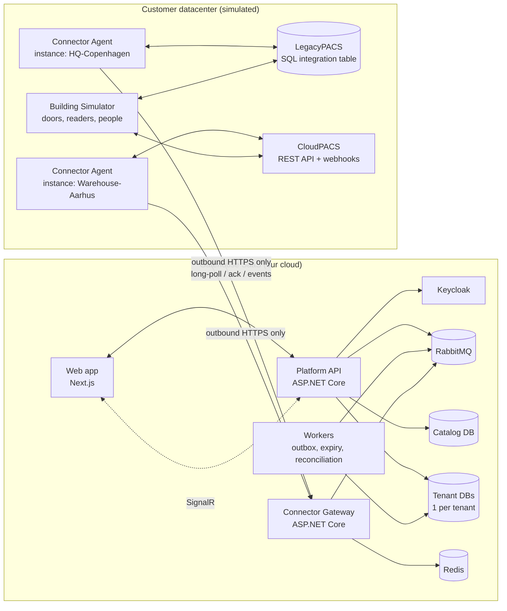
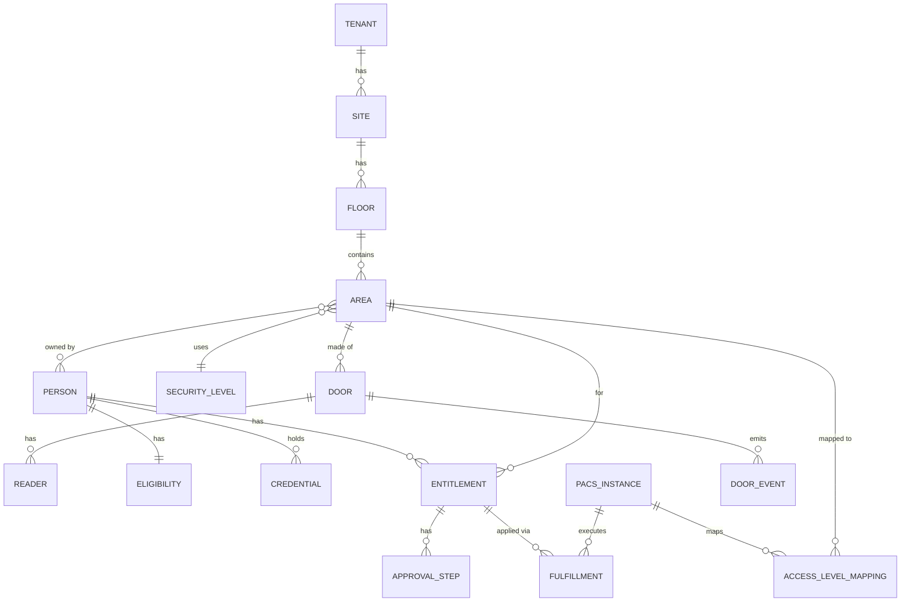
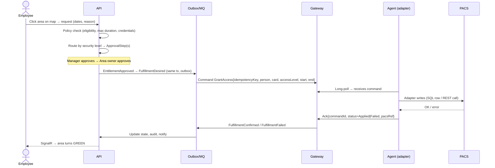
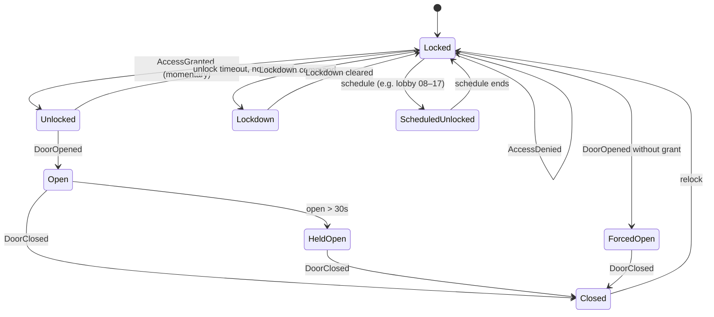

# Gatehouse — Physical Access Governance Platform

> Portfolio project spec · v1.0 · Stefan Ristić
> A multi-tenant, event-driven platform that sits **on top of existing physical access control systems (PACS)**: people request access on a building map, owners approve it, connectors in the customer network apply it, and a live building view shows what is actually happening at every door.

---

## 0. Why this project exists

Most access-control demos stop at CRUD over "users, doors, permissions". Gatehouse is built to show the hard parts of a real enterprise system:

| Skill demonstrated | Where it shows up |
|---|---|
| Enterprise identity | Keycloak brokering per-tenant SAML/OIDC IdPs, magic-link guests, role + scope authorization |
| Multi-tenancy | Database-per-tenant, tenant-resolved connections, isolation tests |
| Event-driven architecture | Commands and events, transactional outbox, idempotency, retries, dead letters |
| Hybrid / edge integration | Connector agent in the "customer network", **outbound HTTPS only** |
| Vendor-agnostic integration | One adapter contract, two very different simulated PACS vendors |
| Correctness under uncertainty | Desired vs confirmed state, reconciliation and drift detection |
| Real-time UX | Live floor plan with door states, badge swipes and alarms over SignalR |
| Security and compliance | Append-only hash-chained audit, PIN reveal safeguards, GDPR retention |
| Quality | Spec acceptance tests as an automated E2E suite, contract tests, chaos toggles |

**Positioning (same as the real-world problem):** Gatehouse is a governance and self-service layer, **not** a replacement access control system. Door controllers keep making the open/deny decision locally. Gatehouse decides *who should have what*, gets it approved, pushes it to the PACS and **tracks whether it was really applied**.

---

## 1. System overview



**Golden rule:** nothing in the cloud ever opens a connection *into* the customer network. Agents pull commands and push events and acknowledgements, all over outbound HTTPS (443).

### Components

| Component | Responsibility |
|---|---|
| **Web app** | Access map, requests, approvals, area owner overview, security staff console, live building view, admin, audit |
| **Platform API** | Domain logic: people, eligibility, entitlements, approvals, fulfillment state, audit. Tenant-aware. |
| **Workers** | Outbox relay, scheduled expiry, renewal triggers, termination processing, reconciliation runs, alerting |
| **Connector Gateway** | The only public endpoint agents talk to: authenticates agents, hands out commands, accepts acks and events |
| **Connector Agent** | Small .NET worker service, one per PACS instance. Hosts exactly one vendor adapter. |
| **PACS simulators** | Two fake vendors with deliberately different integration styles (see §8) |
| **Building Simulator** | Generates realistic traffic: people badging in and out, doors opening and closing, held-open and forced-door alarms |

---

## 2. Tenancy and deployment

- **Catalog DB** holds tenants, their connection strings (encrypted), IdP config references and connector registrations.
- **One PostgreSQL database per tenant.** One application instance serves all tenants; the tenant is resolved per request from the token (`tenant_id` claim) and the matching `DbContext` connection is built at runtime.
- Migrations run against every tenant database (`gatehouse-cli migrate --all`).
- Isolation applies everywhere: sites, areas, roles, SignalR groups, Redis keys, queues (`tenant.{id}.*`) and connector credentials.
- **Deployment models** (documented, with the first one built):
  1. **SaaS**: docker-compose locally, optional k8s Helm chart. ✅
  2. **Hybrid**: customer-hosted in their cloud, same images. 📄
  3. **Isolated / offline**: no internet. Keycloak runs on-prem and covers SSO offline, and updates ship as signed image bundles. 📄

---

## 3. Identity, SSO and roles

### Authentication
- **Keycloak** is the single broker. Each tenant gets a Keycloak **Organization** (or a realm, decided in an ADR) with its own upstream IdP:
  - Tenant "Nordlys A/S": Entra ID via **OIDC** (a dev Entra tenant or a mock OIDC IdP)
  - Tenant "Bricks GmbH": **SAML 2.0** IdP (a second Keycloak acting as a SAML IdP)
- The app always talks plain OIDC (Authorization Code + PKCE) to Keycloak. A BFF pattern in Next.js keeps tokens off the browser.
- **Guests without an IdP** get a **magic link**: single-use, valid for 30 minutes, signed and hashed in the DB. It is implemented as a custom Keycloak authenticator or a platform-issued token exchanged at Keycloak.

### Identity authority (who is employed and until when)
- Kept separate from authentication. Each tenant picks its source: **Entra ID / Workday (mocked HR feed)** or local.
- An HR sync worker imports people plus employment start and end dates, which become **Eligibility**.
- **Local people** (external employees, visitors) need a **sponsor, start date and end date**; a record missing any of them is rejected.

### Roles = role + scope

| Role | Scope | Can | Cannot |
|---|---|---|---|
| Employee | self | view map, request, activate own card, set PIN, upload photo | approve anything |
| Manager | team | request for team, onboard externals, activate cards of people they manage, approve where the level says *manager* | approve own requests |
| Sponsor | sponsored people | set and end sponsorship, request access and activate cards for them | exceed max duration |
| External / Visitor / Guest | self within sponsorship | request, photo, PIN | activate own card |
| Area owner | owned areas | approve per level, roster overview, revoke, access reviews | act outside owned areas, disable people tenant-wide |
| Security staff | tenant or sites | handle fulfillment exceptions, emergency revoke, task-scoped PIN reveal, reconciliation findings, door commands (lockdown, momentary unlock) | approve requests just by role |
| Tenant admin | tenant | people, sites, levels, theme, settings, connectors | approve area access just by being admin |

**Hard rules (server-enforced, with tests):** no self-approval, approval rights separate from admin rights, and every query is filtered by tenant **and** scope.

Authorization is implemented with ASP.NET Core **policy-based authorization** plus resource-based handlers (`AreaOwnerHandler`, `TeamManagerHandler`, `SponsorHandler`).

---

## 4. Domain model



| Entity | Key fields and rules |
|---|---|
| **Person** | source (`Authoritative`, `Local`), type (`Employee`, `External`, `Visitor`, `Guest`), managerId, sponsorId |
| **Eligibility** | start/end with time zone. **The outer limit of every entitlement.** |
| **Credential** | Card (`Assigned → ActivationPending → Active → Deactivated/Revoked`), PIN (encrypted, masked), photo (validated, access-restricted) |
| **SecurityLevel** | per tenant: name, approver chain (`Manager`, `AreaOwner`, `Both`), max duration |
| **Area** | polygon on the floor map, doors, one security level, ≥1 owner |
| **Door / Reader** | PACS-side ids, position on the map, live state (cached in Redis) |
| **Entitlement** | person × area, requested start/end, justification, approval steps, status. Effective end = **min(own end, eligibility end)**. Revocation adds actor, time and reason, and never overwrites the grant. |
| **Fulfillment** | `Desired → Pending → Confirmed / Failed`, plus `Drift`. Records who or what confirmed it (agent or staff) and when (server clock). |
| **PacsInstance** | vendor, connector id, sites covered, capabilities advertised by the adapter |
| **AccessLevelMapping** | area ↔ vendor-specific access level / door group |
| **DoorEvent** | raw events from the PACS: granted, denied, opened, closed, held open, forced, lockdown (time-series table) |
| **ReconciliationReport** | captured-at, compared-at, coverage, findings → remediation tasks |
| **AuditEntry** | append-only, hash-chained (see §10) |

**Invariant:** card state never creates, broadens or removes entitlements, and entitlements never change card state.

---

## 5. Core flows

### 5.1 Request → approve → fulfil → confirm



### 5.2 Map states (never color only)

| State | Rule | Visual |
|---|---|---|
| 🟢 Has access | fulfillment **Confirmed**, now within entitlement window **and** eligibility | green + ✓ icon + label |
| 🔴 No access | no entitlement | red + ✕ + label |
| 🟡 Pending | requested, or approved but not confirmed | hatched amber + ⏳ + label |
| ⚪ Unknown | connector offline / state undeterminable | grey + ? + label |

Confirmed access with an inactive card stays green, with the note *"assigned access; card inactive"*.

### 5.3 Security level matrix (default seed, configurable per tenant)

| Level | Approval chain | Max duration |
|---|---|---|
| Low | Manager | 1 year |
| Medium | Area owner | 1 year |
| High | Manager → Area owner | 6 months |
| Restricted | Manager → Area owner | 30 days |

Requests **never** time out. Escalation and delegation are phase 3 features, and neither can ever skip a required approver.

### 5.4 Revocation
- **Area owner revoke:** a reason is required, there is no extra approval, it becomes `RevokeDesired` and is pending until the agent acks. While unconfirmed it alerts security staff and the tenant admin.
- **Emergency revoke:** priority queue that jumps ahead of normal commands and is audited.
- **Termination:** at the eligibility end, a worker revokes all entitlements, deactivates credentials and ends delegations. Each change is tracked to confirmation.

### 5.5 Card activation
- Employees activate **their own** card with a valid SSO session.
- Externals, visitors and guests **cannot**; their manager **or** sponsor does it (either one is enough).
- Activation is a separate command (`ActivateCard`) and never touches entitlements.

### 5.6 Lifecycle defaults (configurable per tenant)
Max sponsorship 1 year · visitor 7 days · renewal review: employees 5 years, externals 1 year, guests 30 days. Renewal is **never automatic**: reaching the interval starts a renewal request through normal approval, capped at eligibility.

---

## 6. Live building view (the "wow" part)

A real-time operations screen showing what is physically happening in a building.

### 6.1 What you see
- **SVG floor plan** per floor: areas as polygons, doors as icons on walls, readers as dots.
- **Door state** live per door:



- **Animations:** a pulse on the reader for a swipe, green flash for granted, red shake for denied, door swing for opened, blinking red badge for forced or held-open alarms.
- **Live event feed** on the side: `08:42:13 · Anna Larsen · Server Room B · ✅ Granted · Reader R-2.04`
- **Occupancy counters** per area (anti-passback-style in/out readers).
- **Connector health strip:** each PACS instance shows online/offline, last heartbeat, queue depth and last ack latency.
- **Time scrubber:** replay the last 24 h of events on the map.

### 6.2 Security staff actions (from the map)
- **Momentary unlock** of a door (e.g. delivery), audited with a reason.
- **Lockdown** of an area, floor or site. A big red button with a confirmation dialog, sent as a priority command.
- **Acknowledge alarm** (forced or held open) with a comment.
- Click a person in the feed to see their entitlements and recent movements (security staff only; privacy-scoped).

### 6.3 How the data flows
`PACS controller → (vendor-specific) → Agent adapter → normalized DoorEvent → Gateway → RabbitMQ → Event store (Postgres, partitioned by day) + Redis door-state cache → SignalR group tenant:{id}:site:{id}`

Important: **access decisions are made by the PACS** using its own access-level database, which Gatehouse populated. That is why the demo can show *drift*. For example, if someone is added directly in the PACS, they get through the door and reconciliation flags them as **Extra in PACS**.

---

## 7. Event-driven backbone

### 7.1 Messages

| Type | Examples |
|---|---|
| **Domain events** (internal) | `AccessRequested`, `ApprovalGranted`, `EntitlementApproved`, `EntitlementRevoked`, `CardActivated`, `PersonTerminated` |
| **Connector commands** (down) | `UpsertCardholder`, `GrantAccess`, `RevokeAccess`, `ActivateCard`, `SuspendCard`, `SetPin`, `MomentaryUnlock`, `Lockdown`, `ExportRecords` |
| **Connector events** (up) | `CommandAcked`, `DoorEvent`, `RecordExport`, `Heartbeat`, `CapabilitiesReported` |

### 7.2 Guarantees
- **Transactional outbox:** domain change and outgoing message are written in the same DB transaction, and a relay publishes to RabbitMQ (MassTransit).
- **Idempotency:** every command carries an `idempotencyKey`. Agents keep a local processed-keys store (SQLite), so a re-delivered command is acked again without being re-applied.
- **Ordering:** per `(pacsInstance, personId)`, commands carry a sequence number, and the gateway delivers them in order per partition.
- **Retries:** exponential backoff. After N failures the command goes to **Failed**, a task is created and staff are alerted. Nothing silently disappears.
- **Dead letters:** visible in an admin "Message Inspector" page with replay.
- **Offline connectors:** commands queue up and the map shows affected areas as ⚪ *Unknown* with "connector offline since 10:42".

### 7.3 Connector protocol (outbound HTTPS only)

```
POST /connector/v1/poll        long-poll (≤30s), returns batch of commands
POST /connector/v1/acks        [{commandId, idempotencyKey, status, pacsRef, error}]
POST /connector/v1/events      batched DoorEvents (gzip)
POST /connector/v1/heartbeat   {version, capabilities, queueDepth, pacsReachable}
POST /connector/v1/exports     record export for reconciliation (chunked)
```

- **Auth:** each agent has its own **mTLS client certificate** (or OAuth client credentials) bound to exactly one tenant and one PACS instance. The gateway rejects anything outside that scope.
- **Registration:** an admin creates a connector in the UI, which issues a one-time enrollment token. The agent exchanges it for a cert on first start.
- **Versioned contract:** `Gatehouse.Connector.Contracts` NuGet package, shared by gateway and adapters.

### 7.4 Adapter contract

```csharp
public interface IPacsAdapter
{
    PacsCapabilities Capabilities { get; }          // what this vendor supports
    Task<AdapterResult> UpsertCardholderAsync(Cardholder c, CancellationToken ct);
    Task<AdapterResult> GrantAccessAsync(AccessGrant g, CancellationToken ct);   // incl. native start/end
    Task<AdapterResult> RevokeAccessAsync(AccessRevoke r, CancellationToken ct);
    Task<AdapterResult> SetCardStateAsync(CardStateChange s, CancellationToken ct);
    Task<AdapterResult> DoorCommandAsync(DoorCommand d, CancellationToken ct);  // unlock, lockdown
    IAsyncEnumerable<DoorEvent> StreamEventsAsync(CancellationToken ct);
    IAsyncEnumerable<PacsRecord> ExportRecordsAsync(ExportScope s, CancellationToken ct);
}
```

The platform only offers features the adapter's `Capabilities` declare. For example, if a vendor has no PIN write, the UI falls back to the manual PIN reveal flow.

---

## 8. Simulated PACS vendors

Two fake vendors with deliberately different styles, to prove the adapter abstraction.

### 8.1 LegacyPACS: "SQL integration table" style
- Its own PostgreSQL (or SQL Server) DB with `integration_inbox` (we INSERT rows), `cardholders`, `access_levels`, `event_log`.
- A background "controller service" processes the inbox every few seconds, sets `processed_at` / `error`, and is sometimes slow or fails (chaos settings).
- Supports native start/end dates and record export. **No** PIN write and **no** push events: the adapter polls `event_log` by id.

### 8.2 CloudPACS: modern REST style
- Minimal API with OpenAPI: `/cardholders`, `/access-groups`, `/doors/{id}/unlock`, `/events` (webhook **to the agent**, which is local, so this is allowed).
- Rate limits (429), random 5xx and eventual consistency for realism.
- Supports PIN and photo write; no native end dates, so the agent schedules removal itself and flags it as a capability gap.

### 8.3 Building Simulator
- Seeded people with schedules (arrive 08:00 ± 30 min, lunch, meetings, leave).
- Each badge swipe asks the **PACS** (not Gatehouse) for a decision, using its local access data.
- Scenario toggles in a dev panel: *tailgating*, *forced door*, *held open*, *revoked card still works (drift)*, *connector outage*, *PACS slow*, *fire alarm → all doors unlocked*.

---

## 9. Reconciliation and drift

- Runs **monthly** by schedule, plus on demand (big button for demos).
- The agent sends `ExportRecords`, the platform compares them with **confirmed** state, and the report records captured-at, compared-at and coverage (sites, areas, record types).

| Finding | Meaning |
|---|---|
| Missing in PACS | Confirmed here, not in PACS |
| Extra in PACS | In PACS, no matching approved entitlement |
| Mismatch | Person, card, area or dates differ |
| Expired still present | Past its end here, still **active** there (inactive/history rows are not findings) |

- "In sync" is reported **only** for records actually compared. Each finding becomes a remediation task (who, when, action taken), all audited.
- **Live drift detection (bonus):** a `DoorEvent: AccessGranted` for a person without a confirmed entitlement for that area raises an immediate alert.

---

## 10. Audit, privacy and security

- **Audit log:** append-only table and every entry stores `hash = SHA256(prevHash + payload)`. A verifier endpoint proves the chain is intact and the UI shows "Audit chain verified ✓". DB permissions forbid UPDATE/DELETE on it.
- **Covered:** requests, approvals, fulfillments, card activations, PIN reveals, revocations, emergency actions, door commands, reconciliation findings and resolutions, admin changes, sign-ins.
- **PIN:** encrypted at rest (envelope encryption, a local KMS abstraction with AWS KMS / Azure Key Vault providers), masked everywhere. **Show PIN** is only for security staff assigned to that task, re-masks after 30 s, and each reveal is audited **without** the value. PINs never appear in logs (Serilog destructuring policy plus a test that greps logs). The demo uses fictitious PINs only.
- **Photos:** type and size validation, stored in object storage (MinIO) with short-lived signed URLs and access-restricted.
- **GDPR:** retention rules per data category and per tenant (photos, personal data, audit) with an anonymization job and data export for a person.
- **Hardening:** rate limiting, CSP, secure cookies, CSRF on BFF, anti-enumeration on magic links, dependency scanning, secrets via env and Key Vault, OpenTelemetry traces across API → MQ → Gateway → Agent.

---

## 11. Enterprise theming
- Per-tenant design tokens (colors, typography, radius, logo, terminology overrides like "Area" → "Zone").
- A **contrast check** (WCAG AA) runs when colors are saved, and failing pairs are flagged.
- Map state icons and labels are **fixed** and cannot be themed away.

---

## 12. Tech stack

| Layer | Choice |
|---|---|
| Backend | .NET 10 (LTS), ASP.NET Core (Minimal APIs + modular monolith), EF Core, MediatR-style handlers, FluentValidation |
| Messaging | RabbitMQ + MassTransit (outbox, retries, dead letters) |
| Data | PostgreSQL (catalog + DB per tenant, partitioned event tables), Redis (door state, rate limits, SignalR backplane) |
| Identity | Keycloak (orgs/realms, OIDC + SAML brokering, custom magic-link authenticator) |
| Real-time | SignalR |
| Agent | .NET Worker Service, single self-contained binary + Docker image, SQLite for local state |
| Frontend | Next.js (App Router) + TypeScript, Tailwind + shadcn/ui, TanStack Query, SVG floor plans (react-konva or plain SVG), Framer Motion |
| Storage | MinIO (photos, floor plan images, report exports) |
| Observability | OpenTelemetry → Grafana / Tempo / Loki (or Aspire dashboard locally) |
| Local orchestration | **.NET Aspire** AppHost (one `dotnet run` starts everything) + docker-compose alternative |
| Testing | xUnit, Testcontainers, Playwright, Pact (connector contract), k6 (load) |
| CI | GitHub Actions: build, test, SAST, container scan, Playwright on PR |

---

## 13. Repository layout

```
gatehouse/
├─ src/
│  ├─ Gatehouse.AppHost/                # .NET Aspire orchestration
│  ├─ Gatehouse.Api/                    # platform API + SignalR hubs
│  ├─ Gatehouse.Workers/                # outbox relay, expiry, reconciliation, termination
│  ├─ Gatehouse.ConnectorGateway/       # agent-facing endpoint
│  ├─ Gatehouse.Domain/                 # entities, invariants, domain events
│  ├─ Gatehouse.Application/            # use cases, authorization handlers
│  ├─ Gatehouse.Infrastructure/         # EF Core, tenancy, MQ, KMS, storage
│  ├─ Gatehouse.Connector.Contracts/    # shared command/event contract (NuGet)
│  ├─ Gatehouse.Agent/                  # connector agent host
│  ├─ Gatehouse.Adapters.LegacyPacs/
│  ├─ Gatehouse.Adapters.CloudPacs/
│  └─ web/                              # Next.js app
├─ simulators/
│  ├─ LegacyPacs.Simulator/
│  ├─ CloudPacs.Simulator/
│  └─ Building.Simulator/               # people + traffic + chaos scenarios
├─ infra/keycloak/                      # realm exports, test IdPs
├─ tests/
│  ├─ Gatehouse.UnitTests/
│  ├─ Gatehouse.IntegrationTests/       # Testcontainers: Postgres, RabbitMQ, Keycloak
│  ├─ Gatehouse.ContractTests/          # adapter conformance suite (runs vs both vendors)
│  └─ e2e/                              # Playwright acceptance tests
└─ docs/adr/                            # architecture decision records
```

**Adapter conformance suite:** one shared test suite that every adapter must pass (grant → export shows it, revoke → gone, idempotent replay, start/end honoured or capability gap declared). Adding a third vendor means "make the suite green".

---

## 14. Seed data (demo tenants)

| Tenant | IdP | Sites | PACS |
|---|---|---|---|
| **Nordlys A/S** | OIDC (Entra-like) | HQ Copenhagen (3 floors), Warehouse Aarhus | LegacyPACS @ HQ, CloudPACS @ Warehouse |
| **Bricks GmbH** | SAML 2.0 | Berlin Office (1 floor) | CloudPACS |

- About 60 people per tenant: employees, 5 externals with sponsors, visitors and a guest.
- Areas: Lobby (Low, schedule-unlocked 08–17), Office floors (Low), Lab (Medium), Server Room (High), Vault (Restricted), Loading Dock (Medium).
- Demo users (one per role) are listed in `infra/keycloak/demo-users.md`, with generated passwords that are never committed.

---

## 15. Milestones

| # | Milestone | Done when |
|---|---|---|
| M1 | **Skeleton** | Aspire AppHost, catalog + tenant DBs, Keycloak with 2 tenants, sign-in works for both (OIDC + SAML) |
| M2 | **Domain + map** | Sites, floors, areas, map with 4 states, request → approval routing per level, no-self-approval |
| M3 | **Fulfillment (manual)** | Security staff console confirms/fails fulfillment, desired vs confirmed, audit chain |
| M4 | **Event backbone + agent** | Outbox, gateway, agent long-poll/ack, LegacyPACS adapter, idempotency, retries |
| M5 | **Live building** | Building simulator, DoorEvents, SignalR floor plan, alarms, lockdown, connector health |
| M6 | **Second vendor** | CloudPACS adapter, capability gaps in UI, adapter conformance suite green for both |
| M7 | **Reconciliation** | Exports, 4 finding types, coverage, remediation tasks, live drift alert |
| M8 | **Lifecycle** | HR sync, termination automation, renewals, sponsors, magic-link guests, card activation, PIN reveal |
| M9 | **Polish** | Theming + contrast check, GDPR retention, OpenTelemetry dashboards, Playwright suite in CI, demo video |

Stretch goals: escalation and delegation, access reviews (recertification campaigns), anomaly detection on door events, mobile "my badge" PWA, Helm chart, offline install bundle.

---

## 16. Acceptance tests (automated, Playwright + integration)

**Tenancy and identity**
- [ ] A user sees every area of their tenant and none from another tenant (API and UI).
- [ ] Sign-in works for an OIDC tenant and a SAML tenant.
- [ ] A magic link is single-use and refused after 30 minutes; the session ends after 30 minutes.
- [ ] An external or visitor without sponsor, start or end date cannot be saved.

**Map and requests**
- [ ] The map shows 4 states, each with label and icon; themes cannot change them.
- [ ] Viewing or clicking an area grants nothing; it opens a request.
- [ ] Approved but unconfirmed access is **Pending**, never green.
- [ ] Green only when confirmed **and** within the window **and** within eligibility.
- [ ] Routing follows the tenant's matrix; a tenant's custom matrix doesn't affect others.
- [ ] Nobody can approve their own request; pending requests never auto-expire.
- [ ] A request beyond eligibility end is capped or rejected.

**Fulfillment and events**
- [ ] A command delivered twice is applied once (idempotency).
- [ ] With the agent offline, commands queue and affected areas show **Unknown**; after reconnect all apply in order.
- [ ] A PACS failure → Failed + task + alert, never a silent drop.
- [ ] Gateway rejects an agent cert used for another tenant or instance.
- [ ] No inbound connection to the customer network exists (network policy test in compose).

**Revocation and lifecycle**
- [ ] Area owner can revoke only in owned areas, the reason is required, and it stays pending until acked.
- [ ] Unconfirmed revocations alert security staff and the tenant admin until resolved.
- [ ] Emergency revoke jumps the queue and is audited.
- [ ] At termination, all entitlements are revoked and cards deactivated, tracked to confirmation.
- [ ] Card deactivation leaves entitlements intact; activation adds no new areas.

**Live building**
- [ ] A granted swipe appears on the floor plan in < 2 s end to end.
- [ ] A forced door and a held-open door raise alarms; acknowledging them is audited.
- [ ] Lockdown reaches all doors in the scope and the map reflects it.

**Reconciliation**
- [ ] All four finding types are detected; inactive/history rows are not findings.
- [ ] The report shows captured-at, compared-at and coverage, and "in sync" only for compared records.
- [ ] Each finding creates a task; closing it requires an action and is audited.
- [ ] Access granted at the door without an entitlement raises a live drift alert.

**Security**
- [ ] PIN is masked by default, revealed only to task-assigned staff, re-masks after 30 s, and the reveal is audited without the value.
- [ ] PINs never appear in logs or audit exports (automated log scan).
- [ ] Audit chain verification fails if any row is tampered with.

---

## 17. 3-minute demo script (for portfolio / interviews)

1. **Sign in** as Anna (employee, Nordlys, via OIDC). The map shows the HQ floors with states.
2. Click **Server Room** (High) and request access for 2 weeks. The area turns 🟡.
3. Switch to **Manager**, approve; switch to **Area owner**, approve. It is *still* 🟡: approved, not yet applied.
4. Watch the **connector panel**: the command is picked up by the HQ agent and written to the LegacyPACS integration table, the ack arrives, and the map turns 🟢.
5. Open the **Live building view**. The simulator walks Anna to the Server Room, the reader pulses and shows ✅ Granted, and the door swings open and closes.
6. **Kill the connector** container. The areas go ⚪ *Unknown*. An area owner revokes Anna; the revocation is pending and alerts fire.
7. Restart the connector. The queued revoke applies, and Anna's next swipe shows ❌ Denied.
8. Toggle the scenario *"someone added directly in PACS"* and run **reconciliation**. It finds **Extra in PACS** and creates a remediation task.
9. Show the **audit trail**, "chain verified ✓", and the OpenTelemetry trace from the click to the door.
10. Sign in as **Bricks GmbH** via SAML. A different theme, different data, and zero overlap.

---

## 18. Non-goals
- No real hardware, no real controller firmware, no real PACS vendor SDKs.
- Gatehouse never makes the door's open/deny decision.
- No real PINs or personal data. All demo data is synthetic.
- Not a visitor-management kiosk product (visitors exist only as lifecycle records).

---

## 19. Architecture decision records to write
1. Database-per-tenant vs schema-per-tenant
2. Keycloak organizations vs realm-per-tenant
3. Long-poll vs WebSocket for the agent channel (start with long-poll: simplest through corporate proxies)
4. Modular monolith first, with service boundaries at the gateway and agent
5. Outbox with MassTransit vs a custom relay
6. Door events storage: Postgres partitions vs TimescaleDB
7. Map rendering: plain SVG vs canvas (react-konva)
