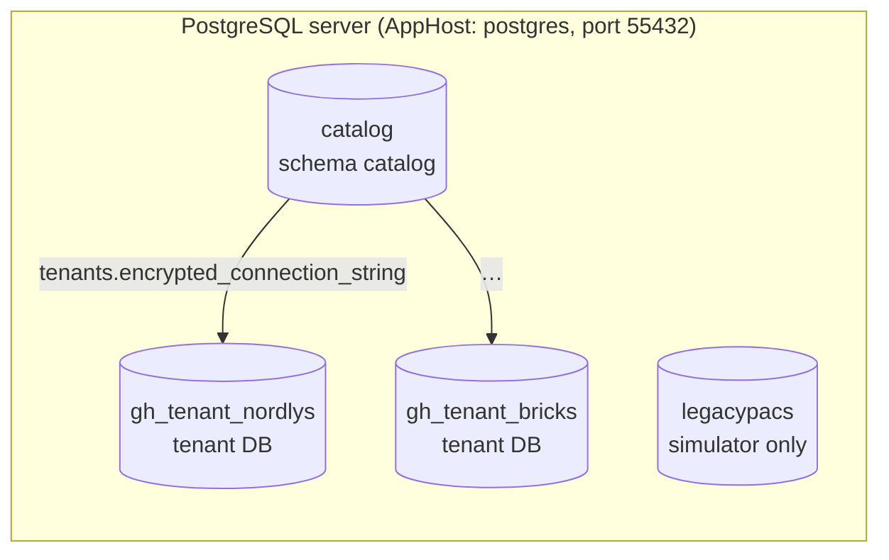
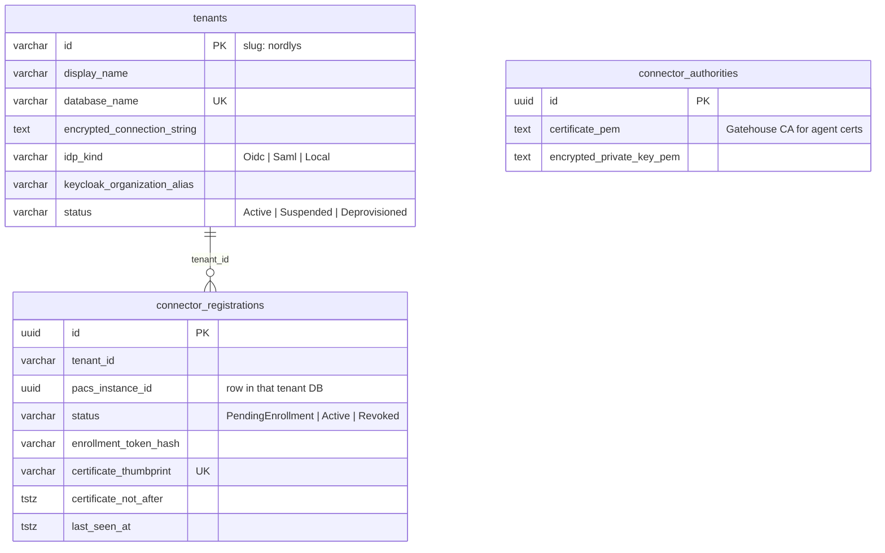
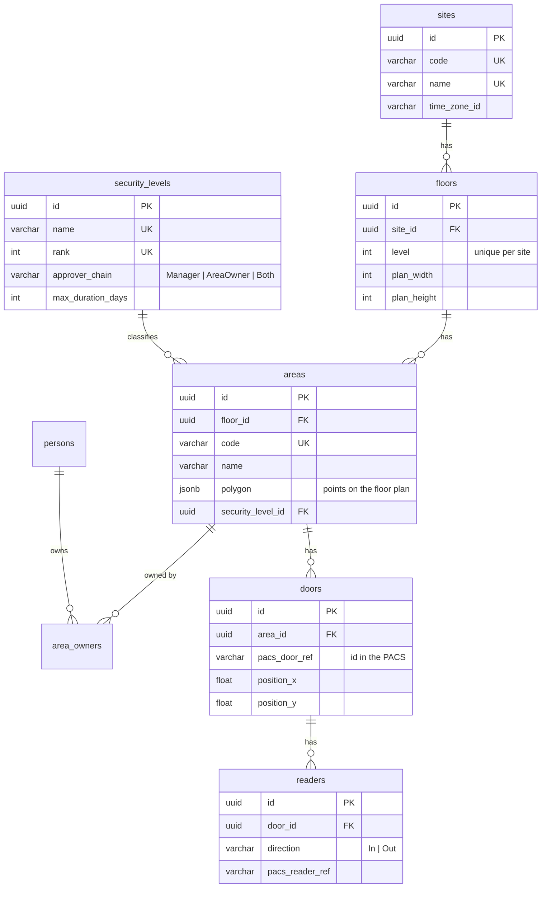
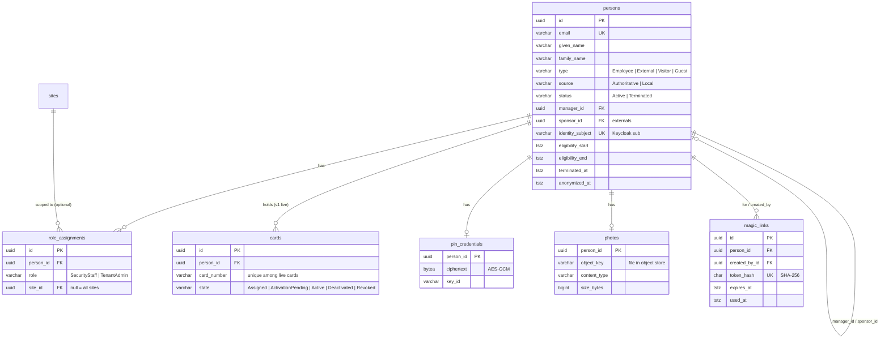
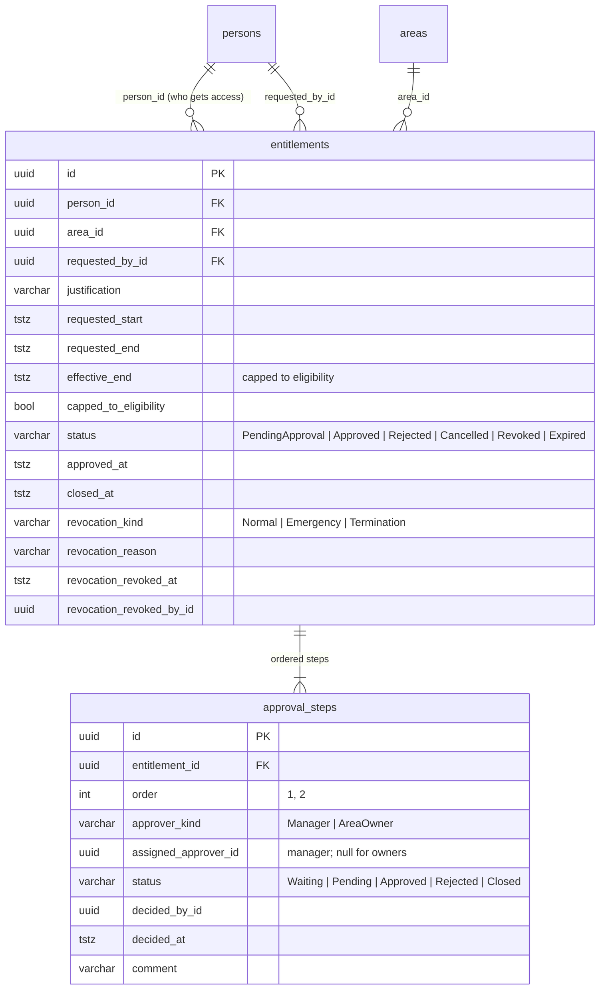
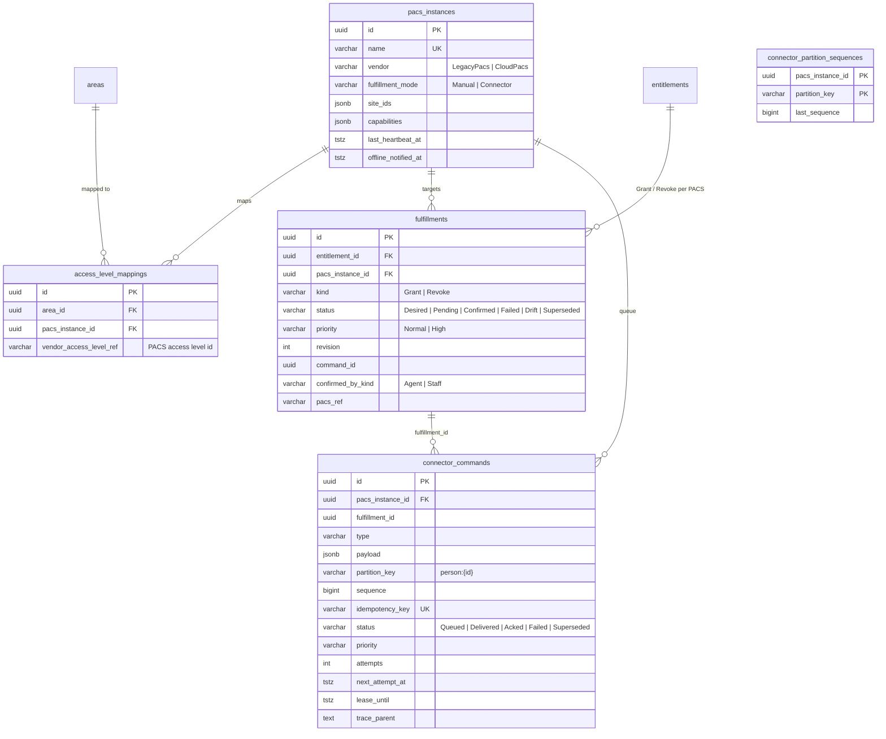
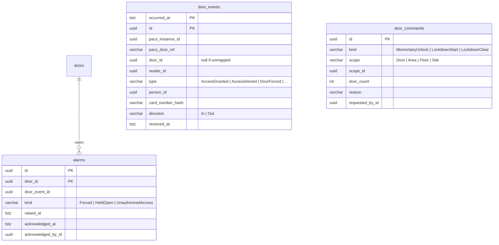
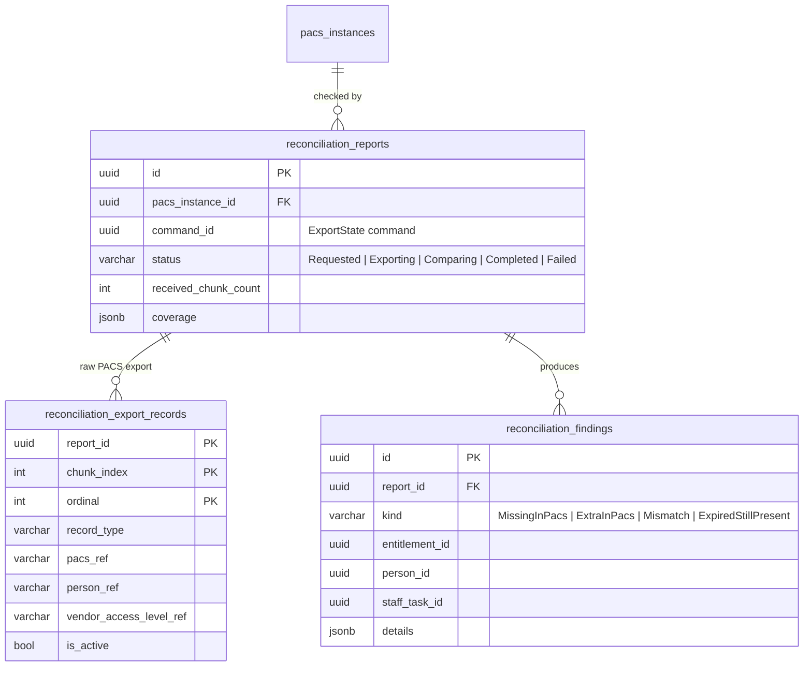

# 1. Database structure

How Gatehouse stores its data, read from the real schema (the EF Core model snapshots under
`src/Gatehouse.Infrastructure/Persistence/{Catalog,Tenant}/Migrations/` and the raw SQL in those migrations).
The normative definition of every entity and its behaviour is `docs/contracts/domain-model.md`; this chapter explains
the physical tables, why they look the way they do, and how one request moves through them.

## 1.1 The big picture: one catalog, one database per tenant

- **Catalog** (`CatalogDbContext`, schema `catalog`): the list of tenants and the connector agents that may talk to Gatehouse.
  It is the only data that is not per-tenant. Three tables.
- **Tenant database** (`TenantDbContext`, schema `public`): everything about one organisation's buildings, people, access,
  PACS and events. Each tenant gets its own physical database (ADR-001), so a bug in a `WHERE` clause cannot leak another
  tenant's rows: the other tenant's data is simply not reachable on that connection. Named `gh_tenant_{slug}` (`TenantId.DatabaseName`); thirty-one tables, identical in every tenant DB.
- **legacypacs** belongs to the LegacyPacs simulator (a stand-in for a vendor PACS); Gatehouse never reads it.

How a request finds its database: the user's token carries `tenant_id` (an agent's client certificate does the same for
agents) → `tenants` row → decrypt `encrypted_connection_string` (AES-GCM with the master key from configuration) →
`TenantDbContext` bound to that connection for the rest of the request. Background jobs loop over active tenants and open
one scope per tenant.

Data that is **not** in PostgreSQL:

| Where | What |
|---|---|
| Keycloak | Identities and passwords. `persons.identity_subject` links a person to their Keycloak user (`sub`). |
| Redis | Fast, rebuildable state: door state `tenant:{t}:door:{id}:state`, occupancy counters `tenant:{t}:occupancy:{date}` (TTL 48 h), connector health and long-poll wake-ups, door-event de-duplication. |
| Object store (RustFS, S3 API) | Photo files. The DB keeps only `photos.object_key`. |
| RabbitMQ | Messages in flight. The source of truth for "must be sent" is `outbox_messages`. |

## 1.2 Conventions you see in every table

| Convention | Why |
|---|---|
| `snake_case`, plural table names | EFCore.NamingConventions; readable SQL. |
| `id uuid` = UUID v7 (`Guid.CreateVersion7()`) | Time-ordered, so inserts append to the index instead of scattering. Exceptions: `tenants.id` is a slug (`nordlys`), `audit_entries.sequence` is a `bigint`, `door_events.id` comes from the agent. |
| Enums stored as strings (`varchar(20)`) | A row reads `PendingApproval`, not `2`; reordering an enum never corrupts data. |
| All instants `timestamptz` in UTC | Time zones (`sites.time_zone_id`, IANA) are only for display and "end of day". |
| `xmin` concurrency token on aggregates | Optimistic locking with PostgreSQL's built-in row version: two approvers clicking at once → the second gets 409, not a lost update. Tables: `areas`, `persons`, `entitlements`, `cards`, `fulfillments`, `connector_commands`, `magic_links`, `reconciliation_reports`, `staff_tasks`. |
| Partial unique indexes (`… WHERE status <> 'Revoked'`) | Invariants that hold only for "live" rows, enforced by the database, e.g. one non-revoked card per person. |
| Foreign keys mostly `Restrict` | You cannot delete a person who has entitlements; people are terminated and later anonymised, not deleted. `Cascade` only for parts that cannot exist alone (doors of an area, readers of a door, owned rows). |
| Some references have no FK on purpose | `door_events` (partitioned, high volume, may arrive for unmapped doors), polymorphic `subject_id` columns (`audit_entries`, `staff_tasks`), approver ids on `approval_steps`, `pacs_instances.site_ids` (JSON array). |

## 1.3 Catalog database

- `connector_registrations` is in the catalog because an agent connects **before** Gatehouse knows its tenant: the
  certificate thumbprint is looked up here and tells which tenant and which `pacs_instances` row it serves.
  Only one non-revoked registration per `(tenant_id, pacs_instance_id)`.
- Enrolment: an admin creates a registration and gets a one-time token (only its SHA-256 hash is stored); the agent
  trades the token for a client certificate signed by `connector_authorities`.

## 1.4 Tenant database by module

### Sites: the building model and the map

- An **area** is what people request ("Lab 2.04"); its polygon is drawn on the floor's SVG plan (ADR-007).
- The **security level** decides who approves (`approver_chain`) and the longest grant (`max_duration_days`).
- `pacs_door_ref` / `pacs_reader_ref` are the PACS's own ids; they let an incoming door event be matched to a door on the map.

### People, roles and credentials

- **Manager and area owner are not roles.** "Manager" is `persons.manager_id` pointing at you; "area owner" is a row in
  `area_owners`. Only `SecurityStaff` and `TenantAdmin` are stored roles, and neither makes you an approver.
- **Eligibility** (`eligibility_start/end`) is the window in which the person may have any access at all (contract end,
  visit end). Access is effective only inside both the entitlement window and the eligibility window.
- `source = Authoritative` rows come from the IdP / HR sync; `Local` rows (visitors, guests) are created in Gatehouse.
- Secrets are never stored in clear: PIN is encrypted (`key_id` names the key, so keys can rotate), magic-link tokens
  and enrolment tokens are hashed, card numbers in events are hashed.
- Retention (M9, `tenant_settings` `retention.*`, defaults 30/365/90 days): after termination photos are deleted, later
  the person is anonymised (`anonymized_at`, PIN and magic links removed, audit kept); door events older than the limit are dropped.

### Access: requests, approvals, revocation

- An **entitlement** is "person P may enter area A from start to end". It is created as `PendingApproval` together with
  its steps, built from the area's security level: `Manager` → one step, `AreaOwner` → one step, `Both` → manager first
  (`order 1`), then area owner (`order 2`). Step 2 is `Waiting` until step 1 is approved, then `Pending`.
- An `AreaOwner` step has no single assignee: any owner of the area (`area_owners`) may decide. The "awaiting my decision"
  query is driven by the index `(status, approver_kind)`.
- No self-approval: the person, and the requester, can never decide their own step (checked in the domain).
- **Revocation** is stored in the same row (`revocation_*` columns, EF "owned type"), not in another table.

### Fulfillment and connectors: getting the decision into the PACS

- **pacs_instances**: one physical access-control system (one vendor installation). `Manual` = staff apply changes by hand
  and confirm in Gatehouse; `Connector` = an agent applies them.
- **access_level_mappings**: Gatehouse thinks in areas, the PACS thinks in "access levels". This table translates; an
  area with no mapping shows `Unknown` on the map.
- **fulfillments**: "this entitlement must be granted (or revoked) in this PACS". One per `(entitlement, PACS, kind)`.
  `revision` increases when it has to be re-sent. The map shows `HasAccess` only when every `Grant` fulfillment is `Confirmed`.
- **connector_commands**: the queue the agent drains by long-polling (ADR-003; the agent only calls out).
  Ordering rules: per `(PACS, partition_key)` at most one command is in flight and they go strictly by `sequence`, so
  "grant then revoke" for one person can never arrive reversed; `connector_partition_sequences` hands out the next number.
  `idempotency_key` makes a retried insert or a retried ack harmless. `lease_until` returns a delivered-but-unacked
  command to the queue. `High` (emergency revocation) skips the queue.

### Live building

- **door_events** is the highest-volume table: everything the PACS reports. It is created by raw SQL, not by EF
  (ADR-006): `PARTITION BY RANGE (occurred_at)` with one partition per day (`door_events_20261110`) plus
  `door_events_default`. `DoorEventPartitionMaintenance` (hourly job) creates tomorrow's partitions and **drops** whole
  days older than `retention.door_event_days`; dropping a partition is instant, unlike deleting millions of rows.
  The primary key must include the partition column, hence `(occurred_at, id)`. Indexes: `(door_id, occurred_at DESC)`,
  `(person_id, occurred_at DESC)` for the door and person histories.
- **alarms**: at most one unacknowledged alarm per `(door, kind)` (partial unique index), so a door that keeps reporting
  "forced" does not flood the console.
- **door_commands**: the record of operator actions (who unlocked or locked down what, and why); the actual command
  travels through `connector_commands` with `High` priority.

### Reconciliation (does the PACS match what Gatehouse expects?)

The agent exports the PACS's current state in chunks (`export_records`, keyed by chunk and position so a re-sent chunk
is a no-op); Gatehouse compares it with confirmed fulfillments and writes `findings`. Every finding opens a staff task.

### Tasks, audit, settings and messaging

| Table | Purpose |
|---|---|
| `staff_tasks` | Work for security staff: `FulfillmentFailed`, `RevocationUnconfirmed`, `ReconciliationFinding`, `DriftAlert`, `PinReveal`. `subject_type` + `subject_id` point at the thing (polymorphic, no FK). At most one unresolved task per `(kind, subject_id)`. |
| `audit_entries` | Append-only history of every decision. `sequence bigint` is the order; `hash = SHA-256(prev_hash, sequence, time, actor, action, subject, payload)`, so changing any old row breaks every later hash (`VerifyAuditChain` checks it). Triggers reject `UPDATE`, `DELETE` and `TRUNCATE`, and those privileges are revoked. |
| `tenant_settings` | Key/value: `theme` (JSON), `retention.photo_days_after_termination`, `retention.personal_data_days_after_termination`, `retention.door_event_days`. |
| `outbox_messages` | Transactional outbox (ADR-005): an event is written **in the same transaction** as the change that caused it; a dispatcher publishes it to RabbitMQ later and sets `dispatched_at`. Nothing is lost if RabbitMQ is down. `trace_parent` keeps one trace from the click to the agent. |
| `processed_messages` | Inbox de-duplication: `(message_id, consumer)` recorded in the consumer's transaction, so a redelivered message is applied once. |
| `__EFMigrationsHistory` | EF bookkeeping: which migrations ran in this database. |

## 1.5 One request through the tables

Anna (Nordlys, employee, manager Mikkel) requests **Lab 2.04** (security level with `approver_chain = Both`):

1. **Request**: `entitlements` row `PendingApproval` (person = requester = Anna, `effective_end` capped to her eligibility);
   `approval_steps` #1 `Manager` `Pending` (assigned to Mikkel), #2 `AreaOwner` `Waiting`; `audit_entries` + `outbox_messages`
   in the same transaction. Map: **Pending** (awaiting approval).
2. **Manager approves**: step 1 `Approved`, step 2 → `Pending`. Any owner of the lab (Sofie, Erik) now sees it.
3. **Owner approves**: step 2 `Approved`, entitlement `Approved`, `approved_at`; for every PACS whose
   `access_level_mappings` cover the lab a `fulfillments` row `Grant`/`Desired`. Map: still **Pending** (awaiting fulfillment).
4. **Dispatch**: the fulfillment turns into a `connector_commands` row (`GrantAccess`, `partition_key person:{Anna}`,
   next `sequence`), fulfillment `Pending`.
5. **Agent**: long-polls, gets the command (`Delivered`, `lease_until`), applies it in the PACS, acks → command `Acked`,
   fulfillment `Confirmed` (`confirmed_by_kind = Agent`). Map: **Has access**.
6. **At the door**: the PACS controller decides by itself; the agent forwards the event → `door_events` row in today's
   partition (`AccessGranted`), Redis door state and occupancy updated, pushed live over SignalR.
7. **Later**: revocation sets `revocation_*` + status `Revoked`, creates a `Revoke` fulfillment (supersedes queued grants),
   and the map shows **Pending** until the PACS confirms removal.

## 1.6 Where to look in code

| What | Where |
|---|---|
| Entities and rules | `src/Gatehouse.Domain/{Module}/` |
| Table mapping | `src/Gatehouse.Infrastructure/Persistence/{Tenant,Catalog}/Configurations/` |
| Migrations | `src/Gatehouse.Infrastructure/Persistence/{Tenant,Catalog}/Migrations/` (tenant: `InitialTenant` → `M9_TraceContext`) |
| Door event partitions | `src/Gatehouse.Infrastructure/LiveBuilding/DoorEventPartitions.cs` |
| Secrets | `src/Gatehouse.Infrastructure/Security/` (`AesGcmSecretProtector`, `LocalPinVault`) |
| Map state from these tables | `docs/contracts/domain-model.md` §3 (`AreaAccessStateCalculator`) |
